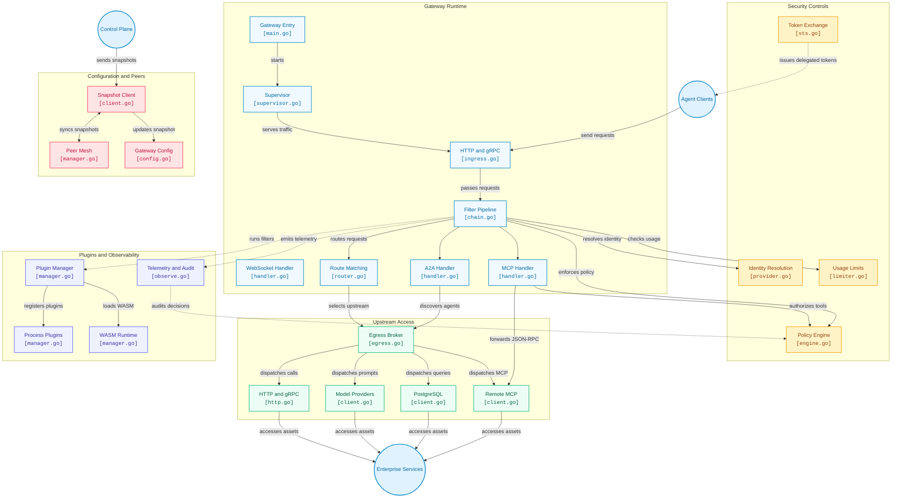

# Torana: The Enterprise Gateway for AI Agents

[](https://go.dev/)
[](LICENSE)
[](CONTRIBUTING.md)
[](CODE_OF_CONDUCT.md)
[](api/proto/controlplane/v1/controlplane.proto)
[](pkg/crypto)

**Torana** is a high-performance, zero-trust security and policy gateway designed specifically for **Autonomous AI Agents**, **Agentic Tool Calling**, and **Enterprise Asset Access**. 

Written in Go (1.25+), Torana acts as the secure DMZ between autonomous agent frameworks (LangGraph, AutoGen, CrewAI, Claude Desktop, OpenAI Swarms) and enterprise environments—governing Model Context Protocol (MCP) tool execution, securing Agent-to-Agent (A2A) communications, and strictly mediating access to sensitive corporate databases, APIs, and knowledge assets.

---

## Why an AI Agent Gateway?

Traditional API gateways protect static REST endpoints. LLM proxies manage token rates and model failover. **AI Agents break both paradigms:**

1. **Non-Deterministic Execution**: Agents formulate their own plans and dynamically select which tools to call with arbitrary generated arguments.
2. **Confused Deputy & Privilege Escalation**: Agents acting on behalf of a human user can inadvertently trigger destructive tools (`drop_table`, `refund_payment`, `send_email`) or exfiltrate private data via tool parameters.
3. **Unfettered Asset Access**: Connecting an autonomous agent directly to databases, vector indexes, and internal microservices creates a massive attack surface.
4. **Multi-Hop Identity Loss**: In multi-agent systems (Agent A delegating to Agent B), original user identity and least-privilege context are lost without cryptographically bound token exchange.

Torana solves this by sitting inline on the hot path as an intelligent, policy-driven security perimeter.

---

## Architecture Overview



---

## Core Capabilities

### 1. Zero-Trust MCP Tool Calling & Least-Privilege Discovery
- **Dynamic Tool Filtering (`tools/list`)**: Intercepts MCP capability discovery. Agents only discover tools they are explicitly authorized to view based on caller identity, groups, and tenancy.
- **Granular Tool Authorization (`tools/call`)**: Enforces inline Common Expression Language (CEL) policies before any tool executes. Restricts invocations based on parameters, roles, and context.
- **Schema Validation & Parameter Sanitization**: Validates tool arguments against strict JSON schemas before forwarding requests to internal tool servers.

### 2. Governed Enterprise Asset & Data Access
- **Secure Egress Brokering**: Native, connection-pooled egress connectors for enterprise storage, PostgreSQL vector databases, internal gRPC/HTTP microservices, and remote MCP servers.
- **Payload Privacy by Design**: Prompts, tool arguments, completions, and asset contents never leave the local customer boundary. Only sanitized operational metadata is emitted to central management planes.
- **Streaming-First Architecture**: Byte-stream evaluation (`io.Reader`/`io.Writer`) with zero body buffering on the hot path unless required by security filters.

### 3. Agent Identity & Multi-Hop Delegation (STS)
- **RFC 8693 Security Token Service**: Downscopes tokens when agents delegate tasks to downstream sub-agents or tool workers.
- **Actor Claim Preservation (`act.sub`)**: Preserves the original human subject while identifying the acting agent chain, maintaining an unforgeable audit trail.
- **Multi-Tenant Isolation**: Cryptographic tenant boundaries prevent cross-tenant agent tool invocations or asset leakage.

### 4. Agent-to-Agent (A2A) Protocol Mesh
- **Agent Card Discovery**: Serves standard agent discovery cards at `/.well-known/agent-card.json` and `/.well-known/agent.json`.
- **Dynamic Skill Negotiation**: Filters agent capabilities and rewrites internal endpoint URLs to gateway-managed public proxies.
- **Autonomous Task Routing**: Manages bidirectional conversational messages and long-running asynchronous task handoffs between agents.

### 5. High-Performance, Cloud-Native Data Plane
- **Lock-Free Hot Path**: Active configuration, routes, and policies are held in immutable snapshots swapped via `sync/atomic.Pointer` with zero request-path locks and zero downtime.
- **WASM & OCI Plugin Sandboxing**: Extend gateway functionality via WebAssembly (`wazero`) or isolated out-of-process plugins without compromising memory safety.
- **Sub-Millisecond Overhead**: Pre-compiled radix matching, buffer pooling (`sync.Pool`), and bounded ring-buffer telemetry designed for latency-sensitive agent loops.

---

## Getting Started

### Prerequisites
- Go 1.25 or higher
- Make
- Docker (optional)

### Running Locally

```bash
# Clone the repository
git clone https://github.com/phaselume/torana.git
cd torana

# Run the gateway data plane
go run ./cmd/gateway-data

# Or build and run using Makefile
make build
./bin/gateway-data
```

### Running Tests, Benchmarks & Fuzzing

Torana includes comprehensive test suites across unit tests, hot-path benchmarks, chaos scenarios, and protocol fuzzers:

```bash
# Run unit and security tests with race detection
make test

# Run hot-path benchmarks
make bench

# Run protocol fuzzing (MCP JSON-RPC, CEL Compiler, Router)
make fuzz

# Run chaos and snapshot reload tests
make chaos
```

#### Core Throughput & Latency Benchmark (`hey`)

Local gateway benchmark measured on macOS (Apple M1) with active upstream routing enabled (50 concurrent workers, 50,000 requests across `localhost`):

```bash
hey -n 50000 -c 50 \
  -m POST \
  -H "Content-Type: application/json" \
  -d '{"model":"gpt-4o","messages":[{"role":"user","content":"ping"}]}' \
  http://localhost:3000/v1/chat/completions
```

| Metric | Measurement (Local with Upstream) |
| :--- | :--- |
| **Throughput** | **23,743 req/sec** |
| **Total Duration** | 2.1059s (50,000 requests) |
| **Average Latency** | **2.1 ms** |
| **p50 Latency** | **1.9 ms** |
| **p75 Latency** | **2.5 ms** |
| **p90 Latency** | **3.1 ms** |
| **p95 Latency** | **3.6 ms** |
| **p99 Latency** | **4.9 ms** |
| **Fastest / Slowest** | 0.2 ms / 28.0 ms |

> **Note on Environment**: Tested locally on localhost (`http://localhost:3000`) with full ingress parsing, routing, and upstream dispatch handling.

<details>
<summary>Click to view full <code>hey</code> terminal output</summary>

```text
Summary:
  Total:        2.1059 secs
  Slowest:      0.0280 secs
  Fastest:      0.0002 secs
  Average:      0.0021 secs
  Requests/sec: 23742.9259
  
  Total data:   2100000 bytes
  Size/request: 42 bytes

Response time histogram:
  0.000 [1]     |
  0.003 [44396] |■■■■■■■■■■■■■■■■■■■■■■■■■■■■■■■■■■■■■■■■
  0.006 [5316]  |■■■■■
  0.009 [199]   |
  0.011 [38]    |
  0.014 [8]     |
  0.017 [6]     |
  0.020 [6]     |
  0.022 [8]     |
  0.025 [17]    |
  0.028 [5]     |

Latency distribution:
  10% in 0.0012 secs
  25% in 0.0015 secs
  50% in 0.0019 secs
  75% in 0.0025 secs
  90% in 0.0031 secs
  95% in 0.0036 secs
  99% in 0.0049 secs

Details (average, fastest, slowest):
  DNS+dialup:   0.0000 secs, 0.0000 secs, 0.0063 secs
  DNS-lookup:   0.0000 secs, 0.0000 secs, 0.0029 secs
  req write:    0.0000 secs, 0.0000 secs, 0.0017 secs
  resp wait:    0.0021 secs, 0.0002 secs, 0.0206 secs
  resp read:    0.0000 secs, 0.0000 secs, 0.0023 secs

Status code distribution:
  [502] 50000 responses
```
</details>

### Container Deployment

```bash
# Build the production Docker image
make docker-build

# Run the container
docker run -p 8080:8080 -p 8443:8443 gateway-data:latest
```

### Container Development (Live Reload)

Changes made on the host are automatically compiled and reloaded inside the running container in real-time via [Air](https://github.com/air-verse/air) and bind volume mounts:

```bash
# Start development container with hot-reloading
make docker-dev
# or using docker compose directly:
docker compose up

# Stop development container
make docker-dev-down
# or:
docker compose down
```


---

## Configuration Example: MCP Tool Policy

Torana snapshots arrive dynamically from the platform control plane or local configuration. Here is an example CEL policy governing agent tool execution:

```yaml
# Example: Restricting sensitive tools to authorized roles
rules:
  - id: "allow-read-only-tools"
    resource: "mcp_tool:*"
    action: "tools/call"
    expression: "ident.in_group('engineering') && resource.id.startsWith('read_')"
    verdict: ALLOW

  - id: "protect-production-db-tools"
    resource: "mcp_tool:database_execute_query"
    action: "tools/call"
    expression: "ident.in_group('dba') && !request.arguments.query.matches('(?i).*(drop|truncate|alter).*')"
    verdict: ALLOW
```

---

## Documentation & Architecture

- **[System Design & Performance Architecture](DESIGN.md)**: Deep dive into the lock-free pipeline, memory pooling, and snapshot compilation.
- **[Security Threat Model & Mitigations](SECURITY.md)**: Threat catalog (T1-T10), sandbox isolation guarantees, and token exchange security.
- **[Core Latency & Benchmarks Guide](test/bench/README.md)**: Testing hot-path latency, p50/p99 percentiles, and throughput.
- **[Contribution Guidelines](CONTRIBUTING.md)**: Complete guide to setting up your local dev environment, coding standards, and submitting PRs.
- **[Code of Conduct](CODE_OF_CONDUCT.md)**: Our standards for an open, welcoming, and inclusive community.

---

## Contributing

We warmly welcome contributions from the open-source community! Whether you are fixing an issue, enhancing MCP tool governance, adding support for new agent frameworks, or optimizing latency on the hot path, your help is appreciated.

- **Get Started**: Read our **[Contribution Guidelines](CONTRIBUTING.md)** for detailed development setup, coding standards, and PR workflows.
- **Community Standards**: We are committed to an inclusive, welcoming environment. Please review our **[Code of Conduct](CODE_OF_CONDUCT.md)**.
- **Good First Issues**: Check out issues labeled [`good first issue`](https://github.com/sanketdhole/torana-enterprise/labels/good%20first%20issue) to jump in right away.
- **Discussions**: Share ideas, propose architectural changes, or ask questions in [GitHub Discussions](https://github.com/sanketdhole/torana-enterprise/discussions).

---

## License

Torana is licensed under the [Apache License 2.0 with Managed Service Clause](LICENSE).

- **Permitted**: Anyone and any enterprise can freely run, deploy, self-host, and modify Torana for their internal business operations and infrastructure.
- **Restricted**: Providing Torana or its control plane as a commercial hosted/managed cloud service (SaaS/PaaS) to third parties is prohibited without a commercial license from the project authors.
